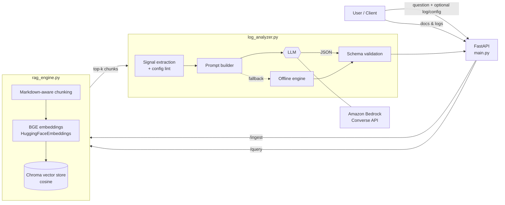

# ☁️ AWS Cloud & Log Intelligence Agent

> Paste an AWS error, a CloudWatch log, or an IAM/security-group config — get a **grounded, structured diagnosis** with probable causes, ordered fix steps, and optimization tips, backed by a RAG knowledge base you can extend at runtime.

Built for **Build, Ship, Shape: Amazon Developer Hackathon 2026** (AWS Builder / Open-Ended category).

---

## ✨ What it does

| Capability | Details |
|---|---|
| **Natural-language troubleshooting** | `POST /query` — ask "Why does my Lambda get `AccessDeniedException` writing to S3?" and get a structured JSON answer |
| **Log understanding** | Extracts AWS error codes, ARNs, services, request IDs, HTTP statuses and Lambda memory pressure before the LLM ever sees the text |
| **Config linting** | Flags `Action: "*"`, public principals, `0.0.0.0/0`, public RDS, disabled encryption, disabled S3 Block Public Access |
| **Live knowledge ingestion** | `POST /ingest` — upload markdown runbooks, `.log`, `.json`, `.yaml` files (or raw text) and they are searchable immediately |
| **Grounded answers** | Every response lists the source chunks (file, section, relevance score) that informed it |
| **Never breaks a demo** | If the LLM is unreachable, an offline engine still answers from detected signals + retrieved docs |

## 🏗️ Architecture



**Stack:** FastAPI · LangChain splitters · `BAAI/bge-small-en-v1.5` (sentence-transformers) · ChromaDB · **Amazon Bedrock** (Converse API; Anthropic/OpenAI optional) · Pydantic v2

## 📁 Project structure

```
aws-agent/
├── main.py            # FastAPI app: CORS, /query, /ingest, /health
├── rag_engine.py      # chunking, BGE embeddings, Chroma store, retrieval
├── log_analyzer.py    # signal extraction, config lint, LLM client, offline fallback
├── requirements.txt
├── .env.example
├── Dockerfile
└── data/sample_docs/  # seed knowledge base + sample Lambda error log
```

## 🚀 Quick start

```bash
git clone <YOUR_REPO_URL> && cd aws-agent
python -m venv .venv && source .venv/bin/activate   # Windows: .venv\Scripts\activate
pip install -r requirements.txt

cp .env.example .env     # configure an LLM (see below) – or leave empty for offline mode
uvicorn main:app --reload --port 8000
```

Open **http://localhost:8000/docs** for the interactive Swagger UI. The first start downloads the BGE model (~130 MB) and indexes the sample docs.

### Choosing the LLM

| Provider | How |
|---|---|
| **Amazon Bedrock** (recommended) | Configure AWS credentials (`aws configure`, env vars or IAM role), enable model access in the Bedrock console, then set `LLM_PROVIDER=bedrock` and `BEDROCK_MODEL_ID` (e.g. `us.amazon.nova-lite-v1:0`) in `.env` |
| Anthropic / OpenAI | Set `ANTHROPIC_API_KEY` or `OPENAI_API_KEY` |
| None | Offline mode: pattern matching + retrieved docs. `/health` and responses report `mode: "offline"` |

IAM permission needed for Bedrock: `bedrock:InvokeModel` (Converse uses it) on the chosen model.

### Docker

```bash
docker build -t aws-log-agent .
docker run -p 8000:8000 --env-file .env aws-log-agent
```

## 🔌 API

### `POST /query`

```bash
curl -X POST http://localhost:8000/query -H "Content-Type: application/json" -d '{
  "question": "Why does my Lambda get AccessDeniedException writing to S3?",
  "log_snippet": "[ERROR] AccessDeniedException ... s3:PutObject on arn:aws:s3:::orders-archive-prod/..."
}'
```

Response (abridged):

```json
{
  "summary": "The Lambda execution role has no identity policy allowing s3:PutObject on the bucket ...",
  "severity": "high",
  "probable_causes": ["Missing s3:PutObject on arn:aws:s3:::orders-archive-prod/*", "Bucket policy or KMS key policy denies the role"],
  "recommended_steps": ["Run `aws sts get-caller-identity` ...", "Add s3:PutObject to the role ..."],
  "optimization_tips": ["Scope Resource to the bucket prefix instead of '*'"],
  "detected_signals": ["error: AccessDenied", "service: s3", "service: sts"],
  "sources": [{"source": "aws_common_errors.md", "section": "AWS Common Errors Cheat Sheet > IAM: AccessDenied / UnauthorizedOperation", "score": 0.71, "snippet": "..."}],
  "mode": "llm",
  "model": "us.amazon.nova-lite-v1:0"
}
```

### `POST /ingest`

```bash
# upload files
curl -X POST http://localhost:8000/ingest -F "files=@my_runbook.md" -F "files=@alb_errors.log"
# or paste text
curl -X POST http://localhost:8000/ingest -F "text=2026-10-20 ERROR ..." -F "source_name=incident-42.log"
```

Supported: `.md .markdown .txt .log .json .yaml .yml` (2 MB each). Re-uploading the same content is idempotent.

### `GET /health`
Reports chunks indexed, embedding model, and whether the LLM or offline mode is active.

## 🧠 Design decisions

- **BGE query instruction** is applied to queries only (not documents) — the recommended usage for BGE retrieval models.
- **Deterministic chunk IDs** (SHA-1 of source + content) make ingestion idempotent.
- **Signals before LLM**: regex extraction and config linting give the model verified facts and reduce hallucination.
- **Graceful degradation**: LLM errors, bad JSON or missing credentials fall back to the offline engine instead of returning a 500.
- **Provider-agnostic LLM layer** (Bedrock Converse / Anthropic / OpenAI) — swap models with one env var.

## ⚠️ Limitations & roadmap

- Config linting is regex-based; a next step is a proper IAM/CloudFormation/Terraform parser.
- Add live CloudWatch Logs Insights ingestion and Bedrock Knowledge Bases / OpenSearch as a managed vector store.
- Add authentication on `/ingest` before any public deployment.
- Strands / AgentCore tool-use so the agent can run read-only AWS CLI checks itself.

## 📄 License

MIT — see [LICENSE](LICENSE).
